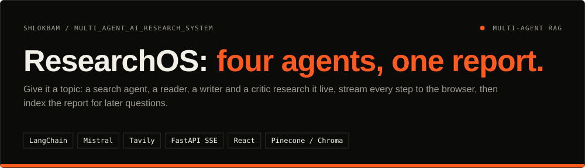
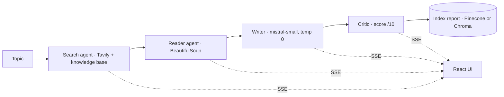
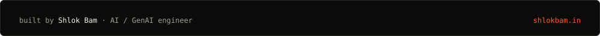

<div align="center">




<a href="https://multi-agent-ai-research-system-six.vercel.app/">Live demo</a> · <a href="#in-one-minute">What it does</a> · <a href="#how-it-works">How it works</a> · <a href="#quickstart">Quickstart</a> · <a href="#design-decisions">Decisions</a> · <a href="docs/DETAILS.md">Full notes</a>

</div>

## In one minute

- **Problem:** "research this for me" chatbots answer from memory, hide their sources and never check their own work.
- **What this does:** four agents split the job. The Search agent finds sources with Tavily, the Reader scrapes the best one, the Writer drafts a report with intro, findings, conclusion and sources, and the Critic scores it out of 10 with strengths and gaps. Every step streams to the UI as it happens.
- **Result:** a sourced report plus an honest review in one run, and each report is indexed so later questions can draw on past research.

## Demo

Try it live: **[multi-agent-ai-research-system-six.vercel.app](https://multi-agent-ai-research-system-six.vercel.app/)**. You can plug in your own Mistral key: `/api/validate-key` checks it, and the server uses it only for your request.

## How it works



| Part | What it does |
| :--- | :--- |
| `agents.py` | The four agents: prompts, tools and model settings |
| `tools.py` | Tavily web search, a BeautifulSoup scraper (3,000-character cap) and a knowledge-base lookup |
| `pipeline.py` | A generator that runs the phases and yields progress events |
| `server.py` | FastAPI: `/api/research` streams status, sources, scraped text, report and critique over SSE |
| `rag_store.py` | Chunks finished reports (~1,000 characters) and stores them in Pinecone, or local Chroma as a fallback |
| `frontend/` | React + Vite UI that renders the stream |

## Quickstart

```bash
python3 -m venv .venv && source .venv/bin/activate
pip install -r requirements.txt

# .env
MISTRAL_API_KEY=...
TAVILY_API_KEY=...
# optional: PINECONE_API_KEY, PINECONE_INDEX_NAME, LANGCHAIN_API_KEY (LangSmith tracing)

python pipeline.py                         # run in the terminal
uvicorn server:app --reload --port 8000    # or serve the API
cd frontend && npm install && npm run dev  # and the UI
```

## Design decisions

- **Specialists over one big prompt.** Each agent has one job and only the tools it needs, so a failure points at a single step.
- **Stream everything.** A generator pipeline plus SSE means the user watches sources arrive instead of waiting a minute for a wall of text.
- **Graceful storage fallback.** Pinecone when a key is set, local Chroma when not, so the project runs anywhere.

## Limits & roadmap

- [ ] The Critic scores the report but its feedback isn't sent back to the Writer yet; a revise loop is the next step
- [ ] The Reader scrapes only the single best URL; reading the top 3 would ground reports better
- [ ] Add an eval set to measure source accuracy instead of relying on the Critic's score

---

<div align="center">

<a href="https://shlokbam.in"></a>

<a href="https://shlokbam.in">shlokbam.in</a> · <a href="https://www.linkedin.com/in/shlokbam/">LinkedIn</a> · <a href="https://github.com/shlokbam">More projects</a>

</div>
